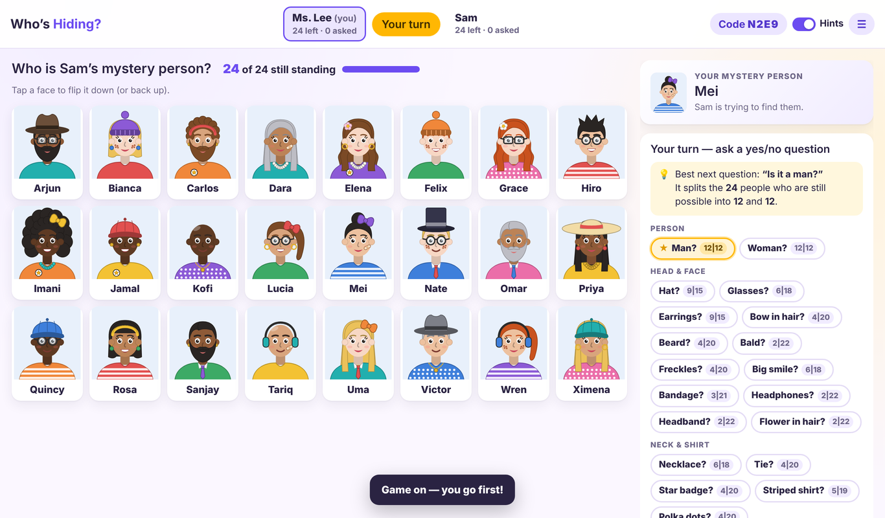

# Who’s Hiding? — a guessing game that teaches binary search

A two-player, guess-the-mystery-person game for the classroom. The teacher hosts a game and gets a
**4-character code and a QR code**. A student scans it (or types the code) and they play on separate devices.
There is also a solo practice mode.



The 24 faces are built around a **decision tree**. Every question splits the faces still standing as evenly as
possible, and **the next question depends on the answer**:

```
Is it a man?
├─ yes → Hat?
│        ├─ yes → Glasses?    ├─ yes → Beard?       ├─ no → Earrings?
│        └─ no  → Beard?      ├─ yes → Gray hair?   ├─ no → Bald?
└─ no  → Earrings?
         ├─ yes → Hat?        ├─ yes → Necklace?    ├─ no → Glasses?
         └─ no  → Bow?        ├─ yes → Black hair?  ├─ no → Red hair?
…and with two faces left, one last question tells them apart.
```

That's 24 → 12 → 6 → 3 → 2 or 1 → 1, so the mystery person is always found in **5 questions or fewer** (8 people in 4,
the other 16 in 5). 24 isn't a power of 2, so a group of 3 can only split 1 and 2. Four questions can only tell
2⁴ = 16 people apart, but five can tell 32 apart.

The tree also hides the pattern. After “Hat? yes” you ask about glasses, but after “Hat? no” you ask about a beard.
The same feature means different things in different branches: a hat is the 2nd question for men, the 3rd for women
with earrings, and just a decoy for other women. Tempting first questions like “Hat?” or “Glasses?” split 10 vs 14.
Only “Is it a man?” splits the board 12 vs 12.

The **teacher guide** (`guide.html`, linked from the home screen) draws the whole tree with every face, shows each
person's path of questions, and has lesson ideas. The tree is defined in one place (`STRATEGY.tree` in
`js/characters.js`), and the in-game hints follow it.

## Putting it online (one time, about 2 minutes)

It’s a plain static website with no server to run and no build step. The easiest host is GitHub Pages:

1. Merge this branch into `main`.
2. GitHub Pages is free for **public** repositories. This repository is currently private, so either make it public
   (Settings → General → Danger Zone → Change visibility; it holds no secrets) or use a paid GitHub plan.
3. Go to **Settings → Pages**. Under “Build and deployment”, choose **Deploy from a branch**, then branch `main`,
   folder `/ (root)`, and click **Save**.
4. After a minute the game is live at **https://nwlb91.github.io/GuessWhoClass/**

Any other static host works too (Netlify, Cloudflare Pages, a school web server). Upload the whole folder.

## Playing in class

1. On your computer, open the site, type your name and click **Host a game**. Put the code and QR code on the
   projector.
2. The student scans the QR code with a phone or tablet, or opens the site and types the code, then enters their name.
3. Both players secretly pick a mystery person. The student asks first.
4. On your turn, tap a question from the list (the game knows the true answer, so nobody can make a mistake) or type
   your own (the other player taps Yes/No). Tap faces to flip them down, or press **Flip down the N who don’t match**.
5. Make a final guess when you know. A wrong guess loses the round (the classic rule).
6. At the end, both players see a “how you narrowed it down” chart, such as 24 → 12 → 6 → 3 → 1.

More tips:

- **Strategy hints** (a toggle in the lobby or in the top bar) show how each question would split the faces still
  standing, for example `12|12` or `10|14`, and star the tree's next question. **Only the host sees hints.** The
  student's device is never sent them, so you can project your screen and think aloud.
- **Players confirm answers** (lobby or ☰ menu): when someone asks a question from the list, the other player sees
  the true answer for their mystery person and taps **Send**. Only the true answer can be sent, but both players
  stay involved. When it's off, list questions are answered instantly.
- **Auto-flip faces that don't match** (lobby or ☰ menu, and in solo practice): after each answer to a list
  question, the faces it rules out flip down by themselves for both players. When it's off, players flip faces
  themselves or press **Flip down the N who don't match**.
- **Next student:** ☰ menu → *Invite a different student* (same code, fresh game).
- **Several games at once:** open the site in more tabs. Each tab hosts its own game with its own code.
  Students can also host games for each other.
- **Lost connection or refreshed the page?** Both sides reconnect to the same game automatically, as long as
  the host’s tab stays open.

## How it works

- `index.html` with `js/app.js` is the game UI. `js/game.js` has the rules: the host’s browser keeps the real game
  state, and each player only receives a view that hides the other player’s mystery person.
- `js/characters.js` defines the cast, the question list and the strategy. `js/avatar.js` draws every face as SVG.
  There are no image files.
- `js/net.js` connects the two browsers directly with WebRTC via [PeerJS](https://peerjs.com). The free public
  PeerJS server only introduces the browsers to each other. No game data is stored anywhere and no accounts are
  needed.
- PeerJS and the QR-code generator are bundled in `vendor/`, so the game doesn’t depend on other CDNs.

**School networks:** the game needs to reach `0.peerjs.com` (to connect) and, on strict networks, PeerJS’s relay
servers (`*.turn.peerjs.com`). If students get stuck on “Connecting…”, ask IT to allow those. Solo practice works
without any connection.

## Tests

```bash
node tests/run-tests.js
```

Checks the cast design and the game rules. For every one of the tree's 23 questions it checks that the question
sends exactly the right people each way and splits them as evenly as possible. It also checks that the yes and no
branches ask different next questions and that everyone is found in 4 or 5 questions.

```bash
npm install --no-save peer playwright && node tests/e2e.js
```

Plays a full two-browser game through a local PeerJS server: join via the link, typed questions, a reload
mid-game, the final guess, rematch, hints and solo mode.

## Credits

All characters and art are original. Third-party libraries (MIT licensed) are listed in `vendor/LICENSES.md`.
